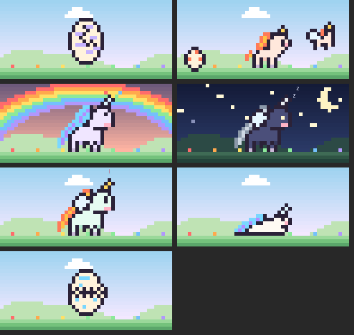

# 한글 Claude Code mods

Claude Code를 한국어로 편하게 쓰기 위한 mod 모음이에요. 일하는 방식대로 자라는 유니콘 펫, 표·코드·mermaid를 읽기 쉽게 그리는 한글 화면, 입력창 꾸미기가 들어 있어요.



## 들어 있는 것

| mod | 하는 일 | 명령어 |
|---|---|---|
| **유니** `yuni` | 옆 패널에서 돌아다니는 유니콘 펫. 입력창 위 정보 줄(컨텍스트·사용량·휴식), 위험한 명령어 경보, 휴식·숨쉬기 알림 | `/yuni` |
| **한글 화면** `hangul-view` | 표·코드·mermaid·제목을 읽기 쉽게 그리고, 도구 줄·스피너·힌트 줄을 한글로 바꿔요 | `/hangul` |
| **입력창 꾸미기** `md-prompt` | 입력하는 동안 코드 블록·굵게·목록·표에 색을 입혀요. 글자는 바꾸지 않아요 | `/md-prompt` |

셋 다 따로 설치할 수 있어요. 필요한 것만 골라 쓰세요.

## 설치

Claude Code 2.1.287 이상이 필요해요. 터미널에서 Claude Code를 열고 프롬프트에 입력하세요.

```
/plugin install yuni --marketplace RJ-Stony/claude-hangul-mods
/plugin install hangul-view --marketplace RJ-Stony/claude-hangul-mods
/plugin install md-prompt --marketplace RJ-Stony/claude-hangul-mods
```

처음엔 마켓플레이스를 추가할지 물어봐요. `y`를 누르고, 설치 범위는 맨 위의 user(모든 프로젝트)를 고르면 돼요.

## 컨텍스트를 먹나요?

**안 먹어요.** 세 mod 모두 화면만 그리고, Claude에게 가는 요청에는 아무것도 붙이지 않아요. 명령어를 직접 실행했을 때 남는 한 줄 결과만 대화에 들어가요.

한글 화면에는 "표·mermaid가 그려진다"는 메모를 Claude에게 붙이는 옵션이 있어요(프롬프트마다 약 190토큰). 이 옵션은 기본으로 꺼져 있어요.

## 유니 🦄

알에서 시작해서, 당신이 어떻게 일하느냐에 따라 다른 유니콘으로 자라요.

| 단계 | 조건 |
|---|---|
| 🥚 알 | 처음 시작. 답변 20번이면 금이 가요 |
| 🐴 아기 망아지 | 답변 50번에 부화. 이때 갈래가 정해져요 |
| 🦄 청년 유니콘 | 답변 200번 |
| 🪽 알리콘 | 답변 500번. 날개가 생겨요 |

- **갈래**: 그때까지 제일 많이 한 일로 정해져요. 코드 수정이 많으면 🔥 불꽃, 검색·읽기는 🌬️ 바람, 명령어는 ⚙️ 강철. 털색 5가지는 무작위예요.
- **반응**: 답변이 끝나면 뿔에서 무지개 반짝이가 터지고, 에러가 나면 울어요. 5분 쉬면 잠들어요.
- **서브에이전트 친구**: 도우미를 부르면 작은 알이 굴러오고, 일이 끝나면 아기 유니콘이 되어 날아가요.
- **컨텍스트·사용량**: 컨텍스트가 85%를 넘으면 배불러서 드러눕고, 사용량이 바닥나면 알 속에 숨어요.
- **뿔 경보**: `rm -rf`, 강제 push, `reset --hard`, `DROP TABLE` 같은 명령어가 나오면 뿔이 빨갛게 깜빡이고, 이미 허락된 상태여도 한 번 더 확인을 받아요.
- **쉼**: 50분마다 스트레칭 알림, 박스 호흡(4-4-4-4), 새벽에는 그만 자라고 말해요.

**입력창 위 정보 줄**

```
🦄 유니 청년 유니콘 Lv.6 │ 코드를 고치고 있어요 ✏️ │ 🧠 42% ⏳ 5시간 31% · 주간 12% ☕ 18분 🥚 2
```

**명령어**: `/yuni` 뒤에 `숨` · `쉬기` · `오늘` · `이름 <이름>` · `알림 <분>` · `정보줄 켜기/끄기`

패널이 저절로 열리려면 터미널이 144칸 이상이어야 해요. 좁으면 `/yuni`로 직접 여세요.

## 한글 화면

- **표**: 한글을 2칸으로 계산해서 칸이 어긋나지 않아요.
- **코드**: 24개 언어 문법 색, 언어 이름 머리줄, 4줄 이상이면 줄 번호, `⧉ 복사` 버튼.
- **mermaid**: 순서도·시퀀스·상태·ER·차트를 상자 그림으로 그려요. 한글 라벨에도 상자가 밀리지 않아요.
- **도구 줄**: `⎿ 명령어 2번 실행 · 파일 3개 읽음`처럼 문장 아래에 흐리게 붙여요. 긴 명령어는 짧게 잘라요.
- **한글 문구**: 스피너("생각하는 중"), 걸린 시간("6분 20초 걸렸어요"), 힌트 줄("? 단축키", "esc 중단"), 모드 표시("자동 모드").
- **테마 15가지**: `/hangul theme nord`. 세부 옵션은 `/config`에서 한글 설명과 함께 바꿀 수 있어요.

## 안전

mod는 내 권한으로 실행돼요. 그래서 이 저장소의 mod는 필요한 것만 써요.

| mod | 쓰는 것 | 안 쓰는 것 |
|---|---|---|
| 유니 | 화면, 타이머, 펫 기록 저장, 컨텍스트·사용량 숫자 읽기 | 파일, 네트워크, 프로그램 실행 |
| 한글 화면 | 화면, 클립보드(복사 버튼), `/hangul copy`할 때 마지막 답변 읽기, 테마 설정 저장, 터미널 종류를 알려주는 환경 변수 읽기 | 파일, 네트워크, 프로그램 실행 |
| 입력창 꾸미기 | 입력창 색칠, 켜기/끄기 설정 저장 | 파일, 네트워크, 프로그램 실행 |

설치 전에 `claude plugin validate <폴더>`로 직접 확인할 수 있어요.

## 다른 mod와 같이 쓸 때

- 패널은 탭으로 나란히 생기고, 정보 줄은 다른 mod의 줄 위에 쌓여요. 덮어쓰지 않아요.
- 한글 화면은 Claude 답변 전체를 다시 그려요. 원본 prismantis처럼 답변을 꾸미는 다른 mod와 같이 켜면 하나만 보여요.

## 만든 사람과 라이선스

- 한글 화면은 [prismantis](https://github.com/NahumLitvin/prismantis)(MIT, Nahum Litvin)를 한글로 옮기고 고친 판이에요.
- 입력창 꾸미기는 [nogu66/md-prompt](https://github.com/nogu66/md-prompt)(MIT)에 한글 문구를 입힌 판이에요.
- 두 원작의 라이선스는 각 폴더의 `LICENSE`에 그대로 있어요. 이 저장소의 나머지(유니 등)는 MIT예요.
